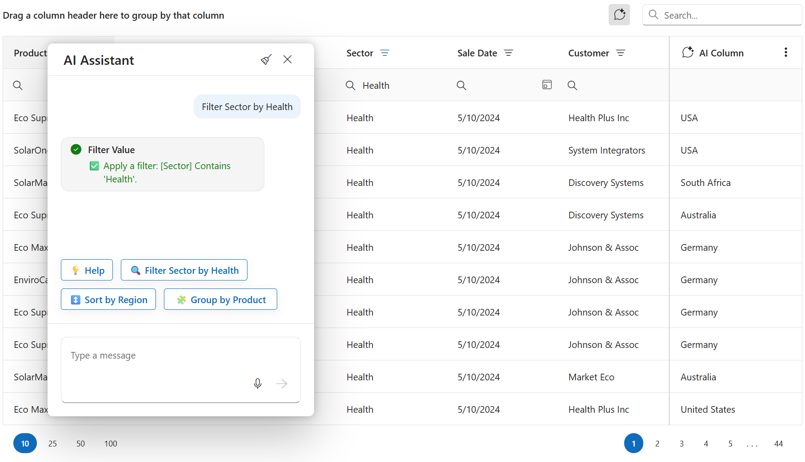

<!-- default badges list -->

[](https://supportcenter.devexpress.com/ticket/details/T1330610)
[](https://docs.devexpress.com/GeneralInformation/403183)
[](#does-this-example-address-your-development-requirementsobjectives)
<!-- default badges end -->
# DevExtreme DataGrid - Azure OpenAI (.NET) Integration

This example uses a minimal ASP.NET Web API backend to configure the following AI-powered [DevExtreme DataGrid](https://js.devexpress.com/Documentation/Guide/UI_Components/DataGrid/Overview/) features:

- [AI columns](https://js.devexpress.com/Documentation/ApiReference/UI_Components/dxDataGrid/Configuration/columns/ai/)
- [AI Assistant](https://js.devexpress.com/Documentation/ApiReference/UI_Components/dxDataGrid/Configuration/aiAssistant/)



## Implementation Details

The [AIIntegrationServer](/AIIntegrationServer/) backend exposes separate endpoints for AI columns and the AI Assistant:

```js
const _SERVER_URL = 'http://localhost:5005/api/ai';

const AI_COLUMN_URL = `${_SERVER_URL}/grid-column`;
const AI_ASSISTANT_URL = `${_SERVER_URL}/assistant`;
```

This example uses endpoint URLs in a factory function to configure two [AIIntegration](https://js.devexpress.com/Documentation/ApiReference/Common_Types/AIIntegration) instances:

```js
function createSendRequest(url) {
    return ({ prompt, data }) => {
        const controller = new AbortController();
        const signal = controller.signal;

        const promise = fetch(url, {
            method: 'POST',
            headers: { 'Content-Type': 'application/json' },
            body: JSON.stringify({ prompt, data }),
            signal,
        })
            .then(response => response.json())
            .then(result => {
                return result.content;
            });

        return {
            promise,
            abort: () => controller.abort(),
        };
    };
}

const columnAiIntegration = new DevExpress.aiIntegration.AIIntegration({
    sendRequest: createSendRequest(AI_COLUMN_URL),
});

const assistantAiIntegration = new DevExpress.aiIntegration.AIIntegration({
    sendRequest: createSendRequest(AI_ASSISTANT_URL),
});
```

## Run the Server

To run the backend, follow the instructions in [AIIntegrationServer README](AIIntegrationServer/README.md).

## Files to Review

- **AI Integration Server**
    - [Program.cs](AIIntegrationServer/Program.cs)
    - [AIIntegrationController.cs](AIIntegrationServer/Controllers/AIIntegrationController.cs)
    - [AIIntegrationRequest.cs](AIIntegrationServer/Models/AIIntegrationRequest.cs)
    - [AzureOpenAIOptions.cs](AIIntegrationServer/Configuration/AzureOpenAIOptions.cs)
- **Angular**
    - [app.component.html](Angular/src/app/app.component.html)
    - [app.component.ts](Angular/src/app/app.component.ts)
    - [ai.service.ts](Angular/src/app/ai.service.ts)
- **React**
    - [App.tsx](React/src/App.tsx)
    - [service.ts](React/src/service.ts)
- **Vue**
    - [App.vue](Vue/src/App.vue)
    - [HomeContent.vue](Vue/src/components/HomeContent.vue)
    - [service.ts](Vue/src/service.ts)
- **jQuery**
    - [index.html](jQuery/src/index.html)
    - [index.js](jQuery/src/index.js)
- **ASP.NET Core**
    - [Index.cshtml](ASP.NET%20Core/Views/Home/Index.cshtml)
    - [grid-ai-service.js](ASP.NET%20Core/wwwroot/js/grid-ai-service.js)
    - [Program.cs](ASP.NET%20Core/Program.cs)

## Documentation

- [DataGrid - AI-Powered Features Overview](https://js.devexpress.com/Documentation/Guide/AI_Features/Overview_of_AI-powered_Features/)
- [DataGrid - AI Column](https://js.devexpress.com/Documentation/Guide/UI_Components/DataGrid/Columns/Column_Types/AI_Columns/)
- [DataGrid - AI Assistant](https://js.devexpress.com/Documentation/ApiReference/UI_Components/dxDataGrid/Configuration/aiAssistant/)
- [AIIntegration Utility](https://js.devexpress.com/Documentation/ApiReference/Common_Types/AIIntegration/)

## More Examples

- [DevExtreme DataGrid - AI Columns Demo](https://js.devexpress.com/Demos/WidgetsGallery/Demo/DataGrid/AIColumns/)
- [DevExtreme DataGrid - AI Assistant Demo](https://js.devexpress.com/Demos/WidgetsGallery/Demo/DataGrid/AIAssistant/)

<!-- feedback -->
## Does This Example Address Your Development Requirements/Objectives?

[](https://www.devexpress.com/support/examples/survey.xml?utm_source=github&utm_campaign=devextreme-datagrid-ai-integration&~~~was_helpful=yes) [](https://www.devexpress.com/support/examples/survey.xml?utm_source=github&utm_campaign=devextreme-datagrid-ai-integration&~~~was_helpful=no)

(you will be redirected to DevExpress.com to submit your response)
<!-- feedback end -->
